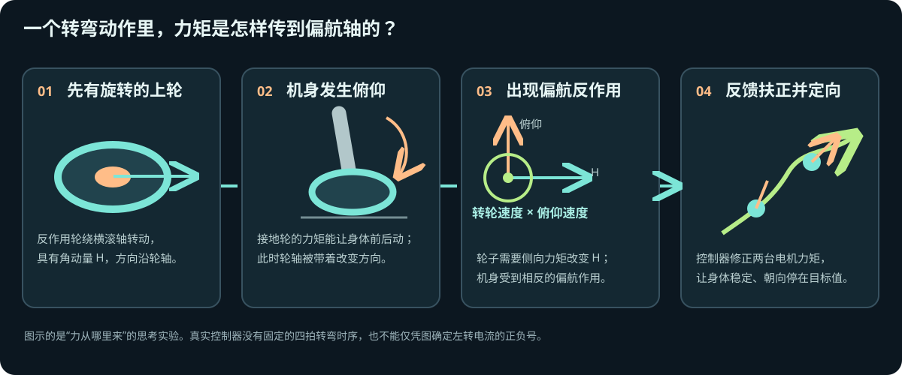
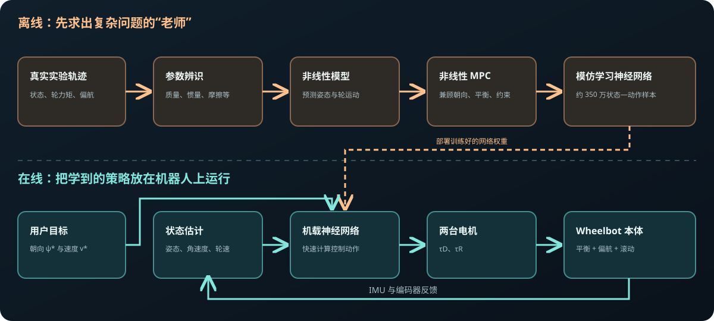

# Wheelbot 到底怎样转向？

**先看动画：**[用可暂停、可拖动的 HTML 动画理解角动量如何让机身转向](turning_mechanism.html)。它把一个理想化转向过程分成“上轮转动 → 机身俯仰 → 偏航速度出现 → 回正后角度留下”四段。以下文字用于补充真实机器的完整动力学与控制方法。

**关键问题：**只有接地轮和反作用轮，两只轮子的轴还互相垂直；没有绕竖直轴的转向电机，机身为什么能改变朝向？

答案是：**让已经旋转的反作用轮，跟随机身做短暂的前后俯仰运动。** 轮轴方向随之改变，轮子的角动量方向也必须改变；轮子因此受到一个偏航方向的力矩，机身受到反方向的力矩。控制器利用这份作用改变朝向，再调节两台电机，让机器人稳定在目标朝向。Mini Wheelbot 论文明确将这种机制称为陀螺效应。[Mini 论文](https://arxiv.org/html/2502.04582)



## 第一步：弄清每只轮子直接做什么

站立时，**下轮接地**。它向前或向后施力，使机身产生俯仰运动，同时能推动机器人滚动。**上轮悬空**。加速它时，电机给机身相反的力矩，直接用于控制左右倾斜（横滚）。两代 Wheelbot 都是这个基本结构；Mini 没有增加第三台转向电机。[原版论文](https://arxiv.org/html/2207.06988)、[Mini 论文](https://arxiv.org/html/2502.04582)

这也意味着：**单独加速上轮，首先得到的是横滚力矩，而不是一个可直接指定的偏航力矩。** 上一版文档没有把这个起点说明白。

## 第二步：让旋转中的上轮随身体“点头”

想象手里拿着一个高速旋转的自行车轮。轮子正在绕自己的轴转；你试着把这根轴向前翻，它会在另一方向“拧”你的手。Wheelbot 的上轮也一样，只不过“手”是机身和电机轴承。

为了说清方向，暂时规定：机器人前方是 **x**、左方是 **y**、上方是 **z**。上轮的角动量 **H** 沿 x 轴。接地轮让机身产生俯仰角速度 **θ̇**，即绕 y 轴转动；上轮被固定在机身上，轮轴也跟着转。于是：

```text
上轮自转：角动量 H 沿 x
机身俯仰：轮轴以角速度 θ̇ 绕 y 改变方向
需要改变 H 的方向：轮子受到绕 z 的陀螺力矩
作用与反作用：机身受到反向的绕 z 力矩 → 偏航 ψ 改变
```

用向量写，这个方向来自 **dH/dt = Ω × H**。例如 `Ω` 指向 `+y`、`H` 指向 `+x` 时，`y × x = −z`：这是**轮子**所需力矩的方向；机身经轴承受到相反的 `+z` 方向作用。把上轮转速或俯仰速度反过来，这个陀螺作用的方向也会反过来。这个例子只说明力矩方向；机器人实际左转还是右转，必须按论文完整坐标定义和当前状态计算。[Mini 论文 §IV-A](https://arxiv.org/html/2502.04582)

### 为什么这里必须有两个“同时发生的量”？

上轮角动量的大小约为 `H ≈ J_R·ω_R`。陀螺作用的量级约为 `J_R·ω_R·θ̇`：

| 反作用轮转速 `ω_R` | 机身俯仰速度 `θ̇` | 这一项会怎样？ |
|---|---|---|
| 有 | 约为零 | 没有因俯仰产生的这一偏航陀螺项 |
| 约为零 | 有 | 同样没有这一项 |
| 有 | 有 | 出现偏航方向的陀螺耦合 |

这不是凭类比猜的。在 [Mini 开源动力学代码的偏航方程](https://github.com/wheelbot/Mini-Wheelbot/blob/main/simulation/python/wheelbot_dynamics/fb.py)中，确实出现了“反作用轮角速度 `dq_R` × 俯仰角速度 `dtheta`”的项。完整方程还包含接地轮转速与横滚速度的耦合、机身惯性，以及轮地接触摩擦；**不能只用这一项计算实际偏航加速度**。[Mini 论文 §IV-A](https://arxiv.org/html/2502.04582)

## 第三步：控制器怎样完成一次“左转”？

下面是**机制示例**，帮助理解控制器要解决的事；论文没有给出一套固定的“左转电流时序”。

1. 用户给出目标：朝向要比现在更偏左，前进速度保持在期望值。
2. 控制器读取当前朝向、横滚、俯仰、两轮转速等状态。它选择两台电机的力矩，使上轮角动量与机身姿态运动形成所需的偏航作用；在此过程中仍要避免机器人倒下。
3. 偏航角速度出现后，控制器继续观察朝向误差，适时调整力矩，让偏航速度降下来，并把横滚、俯仰维持在可平衡范围。**“身体扶正”本身不会自动把朝向转回来**；朝向是偏航角速度随时间积累的结果。
4. 朝向改变后，接地轮继续向前滚动，机器便沿新的朝向走；如果朝向在前进中持续变化，地面轨迹就是曲线。

注意区分 **“机身原地改变朝向”** 和 **“向前走出弯曲路径”**：前者需要产生偏航，后者还需要接地轮滚动。原版论文给出的无滑动近似为 `ẋ = r·q̇_D·cosψ`、`ẏ = r·q̇_D·sinψ`。这两式说明“朝向变了，前进方向就变”，但**它们本身不解释偏航力矩从哪里来**。[原版论文 §IV-B](https://arxiv.org/html/2207.06988)

## 第四步：为什么原版没做成，Mini 做成了？

两者的基本机械原理相同。原版用直立附近的线性 LQR 主要稳定横滚和俯仰；论文观察到偏航运动，却没有实现按指定朝向闭环转向。在线性化平衡点处，前面那个 `ω_R·θ̇` 是两个小量的乘积，一阶线性模型看不到它。Mini 论文的 10 维线性化模型可控性矩阵秩为 **9**，缺少的正是偏航角；这只说明该**局部线性模型**不能控制偏航，完整非线性机器人仍然可以。[原版论文 §VI-A](https://arxiv.org/html/2207.06988)、[Mini 论文 §IV-C](https://arxiv.org/html/2502.04582)

Mini 的做法是：先从实验数据辨识完整非线性模型，再让非线性 MPC 同时规划朝向、平衡和两台电机力矩。因为在线反复求解 MPC 太慢，研究团队用 MPC 生成约 350 万个状态—动作样本，训练神经网络模仿它；机器人上实时运行的是这个快速近似控制器。[Mini 论文 §IV–V](https://arxiv.org/html/2502.04582)



## 最后记住这三句话

1. **转向力矩从哪里来？** 旋转上轮的角动量方向被机身俯仰运动改变，轴承把偏航方向的陀螺反作用传给机身；完整运动还受接地轮、机身和地面接触影响。
2. **为什么不能简单写一条“左转就给上轮多少电流”的规则？** 偏航来自随状态变化的耦合；同时必须平衡、限制轮速，并在到达目标朝向时减小偏航速度。
3. **Mini 比原版多了什么？** 核心是能利用非线性偏航耦合的控制方法，以及支撑它运行的重新设计硬件；不是新添一只转向轮。

资料：[原版论文](https://arxiv.org/html/2207.06988) · [Mini 论文](https://arxiv.org/html/2502.04582) · [Mini 开源动力学模型](https://github.com/wheelbot/Mini-Wheelbot/tree/main/simulation/python/wheelbot_dynamics)。两张图是教学示意，不是论文原图，也不是实际控制器输出的固定动作序列。
