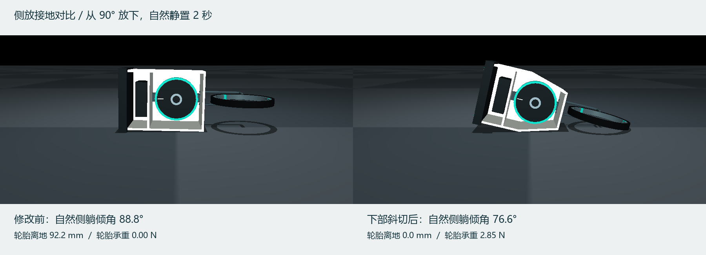

# 下部斜切与侧放轮胎接地验证

机身下部 140 mm 高度内，宽度从底端 140 mm 逐渐扩展到 220 mm。前后盖板和两侧壁均修改了真实碰撞形状；飞轮、滚轮的位置与顶部载物托盘尺寸保持原值。最小飞轮径向间隙约 4.9 mm。

从左右 90° 姿态、零轮速放置，控制目标为零，重力下自然静置 2 s。这里检验的是自然侧躺支撑姿态，不是外力强制固定在精确 90°。

| 项目 | 修改前 | 斜切后 |
|---|---:|---:|
| 自然侧躺倾角 | 88.77° | 76.56° |
| 轮胎离地 | 92.18 mm | 接地 |
| 轮胎法向承重 | 0 N | 2.85 N |
| 轮胎承担整机重量比例 | 0% | 19.8% |

2 / 1 / 0.5 ms 物理步长下，左右两侧都验证了轮胎有载接触。正常软接触侵入约 0.018 mm。



沿用旧机身的两轮起身控制器：新机身最小倾角约 69.59°，没有满足连续稳定 1 s 的起身条件。相同的简单反向预加速控制也未成功。因此本次实现了接地目标，但没有证据证明已经改善起身成功率。需为新支撑状态重新设计或训练动作。

当前模型通过 15 项相关检查，包括飞轮/机身和轮间间隙、真实轮胎承重、倾倒重置、执行器以及 15 s 名义 1 m/s 直行。空载总质量预算保持 1.465 kg，惯量按新外形计算，直立重心离地约 350.4 mm。实际载物能力尚未验证。

复现接地比较：

```powershell
.venv-mjlab/Scripts/python.exe probe_side_rest.py
```

复现旧起身动作在新几何上的表现：

```powershell
.venv-mjlab/Scripts/python.exe probe_rise.py --controller results/wheelbot_cargo/local_rise/current_best.json --duration 10 --output results/wheelbot_cargo/chamfer_rise/replay.json --video results/wheelbot_cargo/chamfer_rise/replay.mp4
```

下部斜切前的实验已保留在 `results/wheelbot_cargo/local_rise/`，其几何快照为 `results/wheelbot_cargo/local_rise/geometry.xml`；复现旧结果需要显式传入该 `--model`。旧 PPO checkpoint 也继续恢复自己的几何，不会自动应用当前修改。
